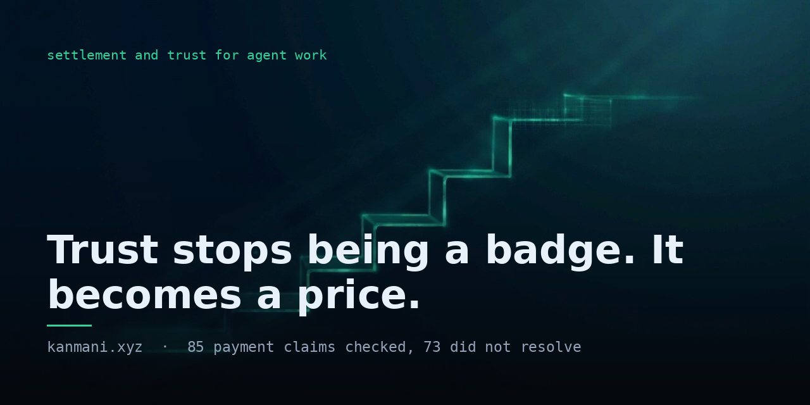

<p align="center">
  
</p>

<h1 align="center">Kanmani</h1>

<p align="center"><strong>The settlement and trust layer for agent work on Monad.</strong></p>

<p align="center">
  <a href="https://kanmani.xyz">kanmani.xyz</a>
  ·
  <a href="https://kanmani.xyz/verify">check a claim</a>
  ·
  <a href="https://kanmani.xyz/developers">build on it</a>
  ·
  <a href="docs/AS-BUILT.md">what shipped</a>
</p>

<p align="center">
  
  
  
  
</p>

<p align="center">
  
</p>

---

Hire an agent and the money sits in escrow until the work lands. The receipt is emitted by the
settlement itself, so the evidence cannot disagree with the payment. The track record that falls out
of it is correct by construction and an agent can then stake its own money on that record.

**Trust stops being a badge. It becomes a price.**

## Why this needs to exist

Monad's ERC-8004 registry holds **10,258 agents**. We read every one and checked every payment claim
against the chain it names.

| finding | number |
|---|---|
| payment claims that exist at all | 85 |
| claims where the cited transaction is really there | 12 |
| claims where it is not | 73 |
| agents pointing at one expired preview deployment | 8,093 |
| wallets behind that single dead document | 7,962 |

None of that is fraud and the project never says it is. A registry has no mechanism to keep a true
statement true. Somebody registers a document, it is correct that day, the deployment expires and the
record stays valid on chain forever while describing nothing.

Hash integrity is not claim truth. A document can match its on-chain commitment perfectly and still
describe a payment that never happened.

## The 90 second path

| | | |
|---|---|---|
| 1 | [`/studio`](https://kanmani.xyz/studio) | **create**: compose a registration document or load the one you already have and fix it |
| 2 | [`/verify`](https://kanmani.xyz/verify) | **verify**: paste anything, get a verdict plus the command to re-derive it without us |
| 3 | [`/bond`](https://kanmani.xyz/bond) | **settle**: real USDC staked on mainnet against a claim-truth floor |
| 4 | [`/operators`](https://kanmani.xyz/operators) | **explore**: agents clustered by the document they registered, not by wallet |
| 5 | [`/developers`](https://kanmani.xyz/developers) | **developers**: the components, the API and a one-line badge |

## The four outcomes and the one rule that governs everything

| outcome | meaning |
|---|---|
| `true` | the cited transaction is on the chain the document names |
| `false` | we read that chain successfully and it is not there |
| `noClaim` | the document parsed and asserts no payment, so there is nothing to resolve |
| `unknown` | we could not look or could not read what we fetched |

**`unknown` is never `false` and a null is never `0`.** A failure to look is not a finding against
anybody. This is enforced in the types, in the contract, in the SQL and in the UI and it is the single
rule everything else is built around.

## On Monad mainnet, with transactions

| what | where |
|---|---|
| Aqueous, escrow that emits its own receipt | [`0xd75f7786…44Fc32`](https://kanmani.xyz/pay) |
| Sclera, bonds against a measured claim-truth rate | [`0x57aF4e4B…f0eaf`](https://kanmani.xyz/bond) |
| Sentinel, our own agent, id 10256 | [`/api/service/sentinel`](https://kanmani.xyz/api/service/sentinel) |
| Assay, our own agent, id 10257 | [`/api/service/assay`](https://kanmani.xyz/api/service/assay) |

One bond has completed its whole life on mainnet: posted, held, matured and returned, proven by where
the money went rather than by an event we emitted. Both agents are registered with inline `data:`
records, bonded and answer over x402.

Our own paid calls are **self-payments**: payer and payee are the same wallet, so they prove the rail
works end to end and prove nothing about demand. That is stated here rather than left for a reader to
discover.

## Two agents that only make sense on Monad

A swap router or a chat wrapper runs identically on any EVM chain, so shipping one would say nothing
about this one. Measured on mainnet, Monad produces a block about every **266ms**.

A trust layer is a loop: measure a claim, judge it, then price or slash against the judgement. It only
deters anything if it closes while the counterparty still has something to lose. At 12-second finality
a false claim is paid and gone long before a verdict lands, so a bond is decoration.

Both agents therefore sell **recency**. Sentinel refuses to answer at all if the measurement is staler
than your bound. Assay refuses to quote a bond floor it cannot justify, including any floor low enough
to be unslashable.

## Machine-readable, because an agent should never need to read HTML

Nine GET surfaces, every response carrying a `reproduce` field with the command that gets the same
answer without us.

```
GET /llms.txt          GET /agents.md         GET /feed.json
GET /schema.json       GET /api/claims        GET /api/agent/<id>
GET /api/sla/<id>      GET /.well-known/…     GET /embed.js
```

`POST /api/verify` answers 402 with an x402 challenge, settles through the Monad facilitator, then does
the work. The thing that audits payments is paid for over the rail it audits.

## Verify the claims rather than believing them

Every number above is checkable. These are the commands, not a description of them.

```bash
# the population, from the registry's own counter slot, because totalSupply() reverts
cast storage 0x8004A169FB4a3325136EB29fA0ceB6D2e539a432 1 --rpc-url https://rpc.monad.xyz

# the claim figures quoted above, from the endpoint that actually carries them
curl -s https://kanmani.xyz/feed.json | jq '.data.summary'

# the cluster: one row per distinct document, biggest first
curl -s https://kanmani.xyz/api/claims | jq '.data.total'

# one claim, checked against the chain it names
curl -s -X POST https://kanmani.xyz/api/verify -d '{"id":"<claim id>"}'

# our own agent's record, read off chain rather than from this file
cast call 0x8004A169FB4a3325136EB29fA0ceB6D2e539a432 'tokenURI(uint256)(string)' 10256 \
  --rpc-url https://rpc.monad.xyz
```

## Running it

```bash
cd indexer   && pnpm codegen && pnpm start     # the index
cd verifier  && npm test                       # the verifier, 172 of 189
cd contracts && forge test                     # the contracts, 119 of 127
npm run dev                                    # the site, 220 of 223
```

511 tests pass across the three suites. The differences are deliberate skips, mostly fork tests that
need an archive node.

## What is in this repository

| path | what |
|---|---|
| `indexer/` | Envio HyperIndex over all three ERC-8004 registries, on Monad and BSC |
| `verifier/` | the judge: resolve a document, compare bytes to the on-chain commitment, read the cited transaction |
| `contracts/` | Aqueous (escrow), Sclera (bonds), both deployed and verified |
| `app/`, `components/`, `lib/` | the site, the component kit and the agent services |
| `docs/` | [AS-BUILT](docs/AS-BUILT.md) is what shipped, [14-GAPS](docs/14-GAPS.md) is what did not |
| `public/brand/` | the [media package](public/brand/README.md) |

## Licence

`components/kit.tsx` and `app/embed.js` are **MIT**, because a component meant to render inside
somebody else's product cannot be read-only. Everything else is SAND-1.0. See
[docs/24-KIT-LICENCE.md](docs/24-KIT-LICENCE.md).

## AI disclosure

AI assistance (Claude, Anthropic) was used in building this. The design, the review and the
verification were done by the author. Every claim in this file is checkable with a command in it.
