<a href="https://kanmani.xyz">
  
</a>

<br>

<p align="center">
  <a href="https://kanmani.xyz"></a>
  <a href="https://kanmani.xyz/verify"></a>
  <a href="https://kanmani.xyz/developers"></a>
</p>

<p align="center">
  
  
  
  
  <a href="docs/AS-BUILT.md"></a>
</p>

<br>

When you hire an agent, the money sits in escrow until the work lands. **The settlement itself
emits the receipt, so the evidence cannot disagree with the payment.** The track record that
results is correct by construction and the agent can then stake its own money on that record.

<p align="center"><sub>
  <a href="#why-this-needs-to-exist">why</a> ·
  <a href="#how-the-money-moves">how</a> ·
  <a href="#the-stack">stack</a> ·
  <a href="#on-monad-mainnet">mainnet</a> ·
  <a href="#for-software">api</a> ·
  <a href="#prove-it-yourself">prove it</a> ·
  <a href="#running-it">run it</a>
</sub></p>

<br>

## Why this needs to exist



Monad's ERC-8004 registry holds **10,258 agents**. We read every one of them and checked every
payment claim against the chain it names.



None of this is fraud and the project never says it is. A registry has no mechanism to keep a true
statement true. Someone registers a document and it is correct that day. Then the deployment
expires and the record stays valid on chain forever while describing nothing.

> [!IMPORTANT]
> **Hash integrity is not claim truth.** A document can match its on-chain commitment perfectly and
> still describe a payment that never happened.

<details>
<summary><b>The same figures, as a table</b></summary>
<br>

| finding | number |
|---|---:|
| payment claims that exist at all | 85 |
| claims where the cited transaction is really there | 12 |
| claims where it is not | 73 |
| **of those 73, real transactions on a different chain** | **64** |
| **of those 73, found on no chain at all** | **9** |
| agents pointing at one expired preview deployment | 8,093 |
| wallets behind that single dead document | 7,962 |

</details>

## How the money moves



## The four outcomes and the one rule that governs everything



Everything else in this repository is built around that one rule.

## The stack



## The 90 second path

<table>
  <tr>
    <td align="center" width="20%"><a href="https://kanmani.xyz/studio"><b>01 · create</b></a><br><sub>Compose a registration document or load the one you already have and fix it.</sub></td>
    <td align="center" width="20%"><a href="https://kanmani.xyz/verify"><b>02 · verify</b></a><br><sub>Paste anything and get a verdict, plus the command to re-derive it without us.</sub></td>
    <td align="center" width="20%"><a href="https://kanmani.xyz/bond"><b>03 · settle</b></a><br><sub>Real USDC staked on mainnet against a claim-truth floor.</sub></td>
    <td align="center" width="20%"><a href="https://kanmani.xyz/operators"><b>04 · explore</b></a><br><sub>Agents clustered by the document they registered, not by wallet.</sub></td>
    <td align="center" width="20%"><a href="https://kanmani.xyz/developers"><b>05 · build</b></a><br><sub>The components, the API and a one-line badge.</sub></td>
  </tr>
</table>

## On Monad mainnet

| what | where |
|---|---|
| **Aqueous**: escrow that emits its own receipt | [`0xd75f7786…44Fc32`](https://kanmani.xyz/pay) |
| **Sclera**: bonds against a measured claim-truth rate | [`0x57aF4e4B…f0eaf`](https://kanmani.xyz/bond) |
| **Sentinel**: our own agent, id 10256 | [`/api/service/sentinel`](https://kanmani.xyz/api/service/sentinel) |
| **Assay**: our own agent, id 10257 | [`/api/service/assay`](https://kanmani.xyz/api/service/assay) |

One bond has completed its whole life on mainnet: posted, held, matured and returned. That is proven
by where the money went, not by an event we emitted. Both agents are registered with inline
`data:` records, are bonded and answer over x402.

> [!NOTE]
> Our own paid calls are **self-payments**: the payer and payee are the same wallet. They prove the
> rail works end to end and they prove nothing about demand. It is stated here so a reader doesn't
> have to discover it.

### Two agents that only make sense on Monad

A swap router or a chat wrapper runs identically on any EVM chain, so shipping one would say nothing
about this chain. Measured on mainnet, Monad produces a block about every **266ms**.

A trust layer is a loop: measure a claim, judge it, then price or slash against that judgement. It
only deters anyone if the loop closes while the counterparty still has something to lose. With
12-second finality, a false claim is paid and gone long before a verdict lands, so a bond is
decoration.

Both agents therefore sell **recency**. **Sentinel** refuses to answer if the measurement is staler
than your bound. **Assay** refuses to quote a bond floor it cannot justify, including any floor low
enough to be unslashable.

## For software

An agent should never need to read HTML. There are nine GET surfaces and every response carries a
`reproduce` field with the command that gets the same answer without us.

<table>
  <tr>
    <td><a href="https://kanmani.xyz/llms.txt"><code>GET /llms.txt</code></a><br><sub>what this is, for a model with no context</sub></td>
    <td><a href="https://kanmani.xyz/agents.md"><code>GET /agents.md</code></a><br><sub>the access contract, in prose an agent can follow</sub></td>
    <td><a href="https://kanmani.xyz/feed.json"><code>GET /feed.json</code></a><br><sub>every verdict, newest first</sub></td>
  </tr>
  <tr>
    <td><a href="https://kanmani.xyz/schema.json"><code>GET /schema.json</code></a><br><sub>the response shape, as JSON Schema</sub></td>
    <td><a href="https://kanmani.xyz/api/claims?outcome=false"><code>GET /api/claims</code></a><br><sub>filter by outcome, chain or agent</sub></td>
    <td><a href="https://kanmani.xyz/api/agent/10252"><code>GET /api/agent/&lt;id&gt;</code></a><br><sub>one agent, its rung and its sample</sub></td>
  </tr>
  <tr>
    <td><a href="https://kanmani.xyz/api/sla/10252"><code>GET /api/sla/&lt;id&gt;</code></a><br><sub>claim-truth rate over a window</sub></td>
    <td><a href="https://kanmani.xyz/.well-known/agent-registration.json"><code>GET /.well-known/…</code></a><br><sub>our own ERC-8004 record, self-hosted</sub></td>
    <td><a href="https://kanmani.xyz/embed.js"><code>GET /embed.js</code></a><br><sub>the badge, with no install and no framework</sub></td>
  </tr>
</table>

`POST /api/verify` answers with a 402 and an x402 challenge, settles through the Monad facilitator,
then does the work. The thing that audits payments is paid for over the rail it audits.

## Prove it yourself

```bash
./scripts/prove.sh
```

The script runs twelve checks across all nine layers. It reads only public endpoints and public
chain state, with no key and no access to our infrastructure, so it runs from a clean machine.

It reports **all nine live**. For three days it reported eight and one built, because Intents had
bridged money to Monad and then stalled unsigned, leaving the escrow empty. It only went green once
the escrow funded itself and the check reads that transfer off chain rather than trusting a status
field. The last recorded run is in [docs/25-PROOF.md](docs/25-PROOF.md).

<details>
<summary><b>Check each number by hand</b>: these are the commands, not a description of them</summary>
<br>

```bash
# the population, from the registry's own counter slot, because totalSupply() reverts
cast storage 0x8004A169FB4a3325136EB29fA0ceB6D2e539a432 1 --rpc-url https://rpc.monad.xyz

# the claim figures quoted above, from the endpoint that actually carries them
curl -s https://kanmani.xyz/feed.json | jq '.data.summary'

# the cluster: one row per distinct document, biggest first
curl -s https://kanmani.xyz/api/claims | jq '.data.total'

# one claim, checked against the chain it names
curl -s -X POST https://kanmani.xyz/api/verify -d '{"id":"<claim id>"}'

# our own agent's record, read off chain rather than from this file
cast call 0x8004A169FB4a3325136EB29fA0ceB6D2e539a432 'tokenURI(uint256)(string)' 10256 \
  --rpc-url https://rpc.monad.xyz
```

</details>

## Running it

```bash
cd indexer   && pnpm codegen && pnpm start     # the index
cd verifier  && npm test                       # the verifier, 181 of 198
cd contracts && forge test                     # the contracts, 119 of 127
npm run dev                                    # the site, 244 of 247
```

544 tests pass across the three suites. The skipped tests are deliberate, mostly fork tests that
need an archive node.

<details>
<summary><b>What is in this repository</b></summary>
<br>

| path | what |
|---|---|
| `indexer/` | Envio HyperIndex over all three ERC-8004 registries, on Monad and BSC |
| `verifier/` | the judge: resolve a document, compare its bytes to the on-chain commitment, read the cited transaction |
| `contracts/` | Aqueous (escrow) and Sclera (bonds), both deployed and verified |
| `app/`, `components/`, `lib/` | the site, the component kit and the agent services |
| `docs/` | [AS-BUILT](docs/AS-BUILT.md) is what shipped, [14-GAPS](docs/14-GAPS.md) is what did not, [17-CONTRACT-AUDIT](docs/17-CONTRACT-AUDIT.md) and [18-BUGS-FIXED](docs/18-BUGS-FIXED.md) are the security review, [25-PROOF](docs/25-PROOF.md) is how to check, [26-CRE](docs/26-CRE-SIMULATION.md) is the oracle run |
| `public/brand/` | the [media package](public/brand/README.md) |
| `public/readme/` | the diagrams in this file, drawn by [`scripts/build-readme-art.py`](scripts/build-readme-art.py) |

</details>

## Security

This build holds and moves real funds and it fetches URLs that strangers put on chain, so it is
reviewed accordingly. [17-CONTRACT-AUDIT.md](docs/17-CONTRACT-AUDIT.md) is the running security
review, with every finding stated as an exploit and a proof. [18-BUGS-FIXED.md](docs/18-BUGS-FIXED.md)
is the plain log of what broke and what now stops it. A full-surface pass on 2026-09-27 across the
contracts, the API, the verifier, the indexer and the oracle is written up there as findings 11
onward. Each fix carries a test that fails against the old code. Items deferred rather than fixed
are named with the reason.

## Licence

`components/kit.tsx` and `app/embed.js` are **MIT**, because a component meant to render inside
someone else's product cannot be read-only. Everything else is SAND-1.0. See
[docs/24-KIT-LICENCE.md](docs/24-KIT-LICENCE.md).

## AI disclosure

AI assistance (Claude, Anthropic) was used in building this. The design, the review and the
verification were done by the author. Every claim in this file is checkable with a command in it.

<br>

<p align="center">
  <a href="https://kanmani.xyz"></a>
  <br>
  <sub><b>Trust stops being a badge. It becomes a price.</b></sub>
</p>
