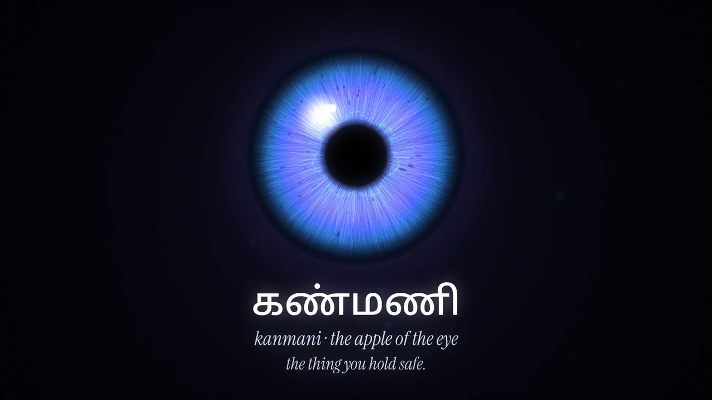
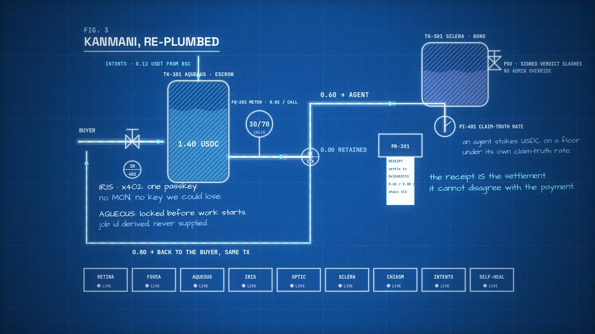
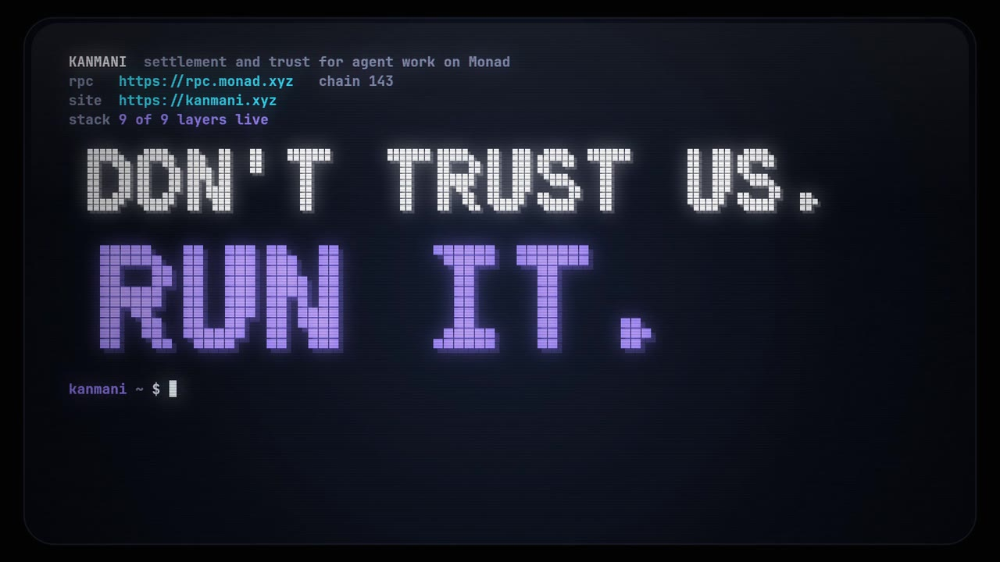
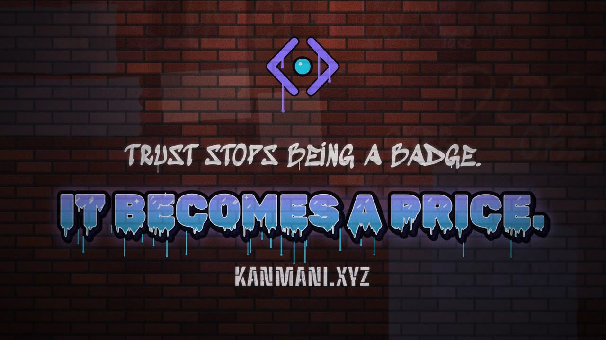

# Pitch films

Four two-minute films, each in a different visual language, each rendered entirely from code. Every figure on screen is one the project publishes: the README, `/feed.json`, `/llms.txt`, the mainnet transactions and the recorded `prove.sh` run. **All nine layers are shown live**, checked against the Intents fund on chain (tx `0x738af85c…a440b558`: 115,558 USDC units from the intermediary into Aqueous).

| | film | the idea | watch |
|---|---|---|---|
|  | **The Eye** | *Kanmani* (கண்மணி) is Tamil for the pupil, "the apple of the eye". The stack is named for the eye, so a payment claim travels through it as light: cornea, aqueous, iris, retina, fovea, optic, chiasm, sclera. | [720p](eye/kanmani-eye-720p.mp4) |
|  | **The Plumbing** | "A plumbing problem, not a lying problem." A blueprint in four figures: the registry as built, one dead document, the machine re-plumbed (passkey valve, escrow tank, meter, settle tee, receipt, bond), and a pressure test on mainnet. | [720p](plumbing/kanmani-plumbing-720p.mp4) |
|  | **Run It** | "Don't trust us. Run it." A CRT terminal session. Every command is real and every output is what the live site, the chain or the repository returned, including the full `prove.sh` run: PASS 12, FAIL 0, all nine live. | [720p](run-it/kanmani-run-it-720p.mp4) |
|  | **Hold It Safe** | Graffiti on a night wall. Each beat of the pitch is sprayed, stencilled, stickered or wheatpasted onto the next stretch of wall, cut to boom-bap. | [720p](graffiti/kanmani-graffiti-720p.mp4) |

## What each one says

All four tell the same story: a registry that can't tell a working counterparty from a dead one, a check that reads the chain each claim names, a settlement that writes its own receipt, and a track record that becomes a price. Each one puts the weight somewhere different:

- **The Eye** is the architecture. Each layer does the job its namesake does, and self-heal is a blink: the stale verdict drops back to *unknown* and re-reads.
- **The Plumbing** is the money: 1.40 USDC escrowed, 30 of 70 calls metered at 0.02, 0.60 to the agent, 0.80 back in the same transaction, 0 kept. Then the bond, the relief valve a signed verdict opens, and the second inlet from BSC.
- **Run It** is verifiability. It is the one to show a developer or a judge who wants to check.
- **Hold It Safe** is the energy piece for an audience.

The house rules hold in all four:
- Green means true, red means false, and slate means unknown, never false. Brand violet/cyan never stand in for a verdict.
- The self-payments are called what they are: they prove the rail, not demand.
- The terminal's phosphor is cool white. It isn't green or amber, because on this project both colours carry meaning.

## Layout

```
pitch/
  lib/core.js, lib/audio.py     shared film core and synthesis
  render.mjs                    FILM=<name> renders any film headlessly, in parallel, frame-exact
  eye/  plumbing/  run-it/  graffiti/
    index.html, film.js         the film (graffiti splits it into engine.js, scenes.js, film.js)
    soundtrack.py               its score and foley, synthesised from the film's own cue list
    poster.jpg, *-720p.mp4      the cut
  fonts/                        bundled under their own licences (OFL 1.1 / Apache 2.0)
```

Nothing is filmed, sampled or licensed. `renderFrame(t)` depends only on `t`, so any frame renders on its own and a re-render is identical.

| film | tempo | score |
|---|---|---|
| The Eye | 80 BPM | Cinematic D minor resolving to D major: heartbeat, glass arpeggios, the chain's 266 ms pulse |
| The Plumbing | 96 BPM | Marimba and clockwork over a warm groove, with pen, valve, fluid, meter and printer foley |
| Run It | 120 BPM | E-minor darksynth with a side-chained bass; every keystroke is a cue |
| Hold It Safe | 90 BPM | Boom-bap, with spray, rattle, stamp and DJ-scratch foley |

## Render

```bash
export FILM=eye                                              # eye | plumbing | run-it | graffiti
node pitch/render.mjs cues                                   # the sound cue list
python3 pitch/$FILM/soundtrack.py pitch/out/$FILM/cues.json pitch/out/$FILM/soundtrack.wav
node pitch/render.mjs video 6                                # 3,600 frames, 2 to 3 minutes on 8 cores
node pitch/render.mjs mux                                    # -> pitch/out/$FILM/kanmani-pitch.mp4
node pitch/render.mjs sheet 10 40 70 100                     # contact sheet of any moments
```

You need Node with Playwright's Chromium, Python 3 with `numpy` and `scipy`, and ffmpeg. If `FFMPEG` is unset, the script uses the binary bundled with `imageio-ffmpeg`. You can also open `pitch/<film>/index.html` over http with `?t=42` to scrub to a moment, or `?play` to watch it live. When a number changes, edit the film and re-render; the sound follows because it reads its cues from the film.
